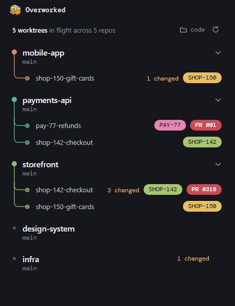
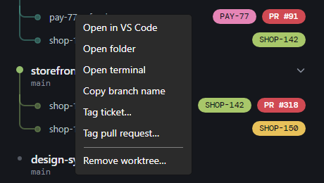
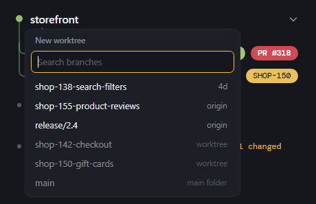
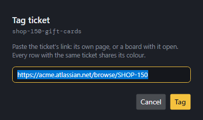

<p align="center"></p>

<h1 align="center">Overworked</h1>

<p align="center">One window for every repo and git worktree you're juggling. Windows and macOS.</p>

<p align="center"></p>

## Why

Working on a few things at once usually means git worktrees: a folder per branch, so you're not stashing and
switching all day. But they pile up across repos, and it gets hard to keep track of which folder is which branch,
what still has uncommitted work, which repos a ticket touches, and whether it has a pull request yet.

Overworked shows every repo in one folder with its worktrees underneath, and keeps the list current as you work:

- **Tickets in colour.** Tag a worktree with its ticket, and every repo working on that ticket shows it in the same colour.
  Open all of a ticket's repos in one VS Code window, or add another repo to it in one step.
- **Pull requests at a glance.** Tag it with its PR, and a pill links straight to it.
- **Nothing lost.** Uncommitted work shows as "3 changed" and commits origin doesn't have yet as "2 unpushed", and
  removing a worktree asks before throwing work away.
- **Tidy after merging.** Once a PR is merged and its branch deleted on origin, its worktree gets a **Clean up** button
  (so does a repo whose own folder was left on that branch).
- **Ready to run.** New worktrees get copies of your local, gitignored files, like `appsettings.local.json`, listed in
  a `.worktreeinclude` that Overworked keeps outside the repo.
- **One click** opens any worktree in VS Code, a terminal or your file browser.
- **A command line, `ow`,** does the same things, for scripts and AI coding agents.

## Get started

You need [git](https://git-scm.com/downloads) and the [.NET 9 SDK](https://dotnet.microsoft.com/download/dotnet/9.0).

### Windows

```powershell
git clone https://github.com/Andrew-AH/Overworked.git   # or unzip a copy
cd Overworked
dotnet run --project src/Overworked.App                  # starts the app
```

For an `Overworked.exe` you can keep and pin to the taskbar:

```powershell
dotnet publish src/Overworked.App -c Release -r win-x64 --self-contained -p:PublishSingleFile=true -p:IncludeNativeLibrariesForSelfExtract=true -p:DebugType=none -o publish/win
# the app is now publish\win\Overworked.exe
```

### macOS

```bash
brew install --cask dotnet-sdk                           # if you don't have .NET yet
git clone https://github.com/Andrew-AH/Overworked.git    # or unzip a copy
cd Overworked
./mac/package.sh                                         # builds the app and a .dmg (Intel Mac: ./mac/package.sh osx-x64)
open publish/mac/Overworked-*.dmg                        # drag Overworked into Applications
```

### The `ow` command (Windows and macOS)

```
dotnet pack src/Overworked.Cli -c Release -o nupkg
dotnet tool install -g Overworked.Cli --add-source ./nupkg   # adds `ow` to your PATH
```

### First run

Click **Choose folder** and pick the folder your repos live in (say `C:\code` or `~/code`). Each repo in it appears
with its worktrees underneath, and the repos you have worktrees in sit at the top. New worktrees go in
`.worktrees/<repo>/<branch>` inside that folder.

## Using it

| Do this | To |
|---|---|
| **Double-click** a row | open it in VS Code |
| **+** on a repo | open any branch as a worktree, or type a new name to branch from `origin/main` |
| **Right-click** a worktree | open it in VS Code, a folder or a terminal; copy its branch; tag it; work with its ticket; remove it |
| **Right-click** a repo | switch its branch, plus the same actions |
| **Click** a tag | open the ticket or pull request |
| **↻** at the top | rescan, and check origin for branches deleted there; it spins while that runs (opening the app does this too, and it runs by itself every minute) |
| **Clean up** on a worktree | remove it after its branch was deleted on origin, say by a squash merge |
| **Clean up** on a repo | switch its own folder back to main after the branch it was on was deleted on origin |

<table>
  <tr>
    <td></td>
    <td></td>
  </tr>
  <tr>
    <td align="center">Right-click a worktree</td>
    <td align="center">+ opens a branch as a worktree</td>
  </tr>
</table>

### Tags

Right-click a row, choose **Tag ticket…** or **Tag pull request…**, and paste the link. A branch can have both.

<p align="center"></p>

- Ticket links can come from any company's Jira, cloud or self-hosted, or any tracker with keys like `PROJ-123`:
  the ticket's own page (`…/browse/PROJ-123`) or a board with it open (`…?selectedIssue=PROJ-123`).
- Each ticket gets its own colour, shared by every row tagged with it.
- A row with a ticket can **Open PROJ-123 in VS Code** (every repo on that ticket, in one window) or **Add a repo to
  PROJ-123**, which opens the same branch in the repo you pick and tags it with the same ticket.
- Deleting a branch drops its tags.

## Command line

`ow` does what the app does, from a terminal. The app updates as soon as `ow` changes something.

```
ow app                               open the app
ow root [folder]                     show or set the folder that holds your repos
ow list [repo]                       repos and their worktrees
ow path <repo> [branch]              folder of a repo, or of a branch's worktree
ow branches <repo> [--fetch]         branches, newest first, and where each is checked out
ow new <repo> <branch>               open a branch as a worktree (a new name branches from origin/main)
ow switch <repo> <branch> [--create] switch a repo's own branch
ow remove <repo> <branch> [--force]  remove a worktree; refuses if work would be lost unless --force
ow cleanup [repo] [branch]           check origin, then clean up every branch deleted there (as Clean up does)
ow pr <repo> <branch> <url>          tag a branch with its pull request
ow ticket <repo> <branch> <url>      tag a branch with its ticket
```

Add `--json` to any command for output a script can read.

For Claude Code, [`.claude/skills`](.claude/skills) has three skills built on `ow`. They load in this repo; to use them
in every repo, copy their folders into `~/.claude/skills`.

- **managing-worktrees** does worktree work through `ow` rather than raw `git worktree`.
- **/jira** writes and creates a Jira ticket (or takes an existing one), opens a worktree for it in each repo you
  pick, and tags them with the ticket.
- **/pr** opens a GitHub pull request with a short Summary and Changes, using the branch's ticket tag, and tags the
  branch with the PR.

## Good to know

- Git is the source of truth. Overworked only remembers your repos folder (`%APPDATA%\Overworked\config.json` on
  Windows, `~/.config/Overworked/config.json` on macOS), and tags live in each repo's own git config.
- Removing a worktree keeps its branch. If VS Code or a terminal still has the folder open, the empty folder goes
  on a later refresh.
- **Clean up** also deletes the worktree's local branch, but only if origin had every commit on it. If there's
  anything newer, or it can't tell (the branch was pruned by some other fetch first), the branch stays. On a repo's
  own folder it refuses while there are uncommitted changes.
- A repo's `.worktreeinclude` lives with its worktrees, in `.worktrees/<repo>/.worktreeinclude` under your repos
  folder, never in the repo itself. It uses `.gitignore` syntax, and a new worktree gets a copy of each file in the
  repo's own folder that it matches and git ignores, for example:

  ```
  **/appsettings.local.json
  .vscode/
  ```
- The Mac build is signed for the Mac that built it. To open a copy on another Mac, allow it under System Settings →
  Privacy & Security → Open Anyway.

## Development

```
dotnet test
```

To update an installed `ow`, bump `<Version>` in `src/Overworked.Cli/Overworked.Cli.csproj`, pack again, and run
`dotnet tool update -g Overworked.Cli --add-source ./nupkg`.

```
src/Overworked.Core            git operations, scanning, tags, config (no UI)
src/Overworked.App             the Avalonia app: ViewModels/ hold state and changes, Views/ the window and menus
src/Overworked.Cli             the `ow` command; JsonOutput.cs is its --json contract
mac/package.sh                 builds Overworked.app and its .dmg (run on a Mac)
tests/                         real git against throwaway repos, plus unit tests
docs/                          README screenshots
```
